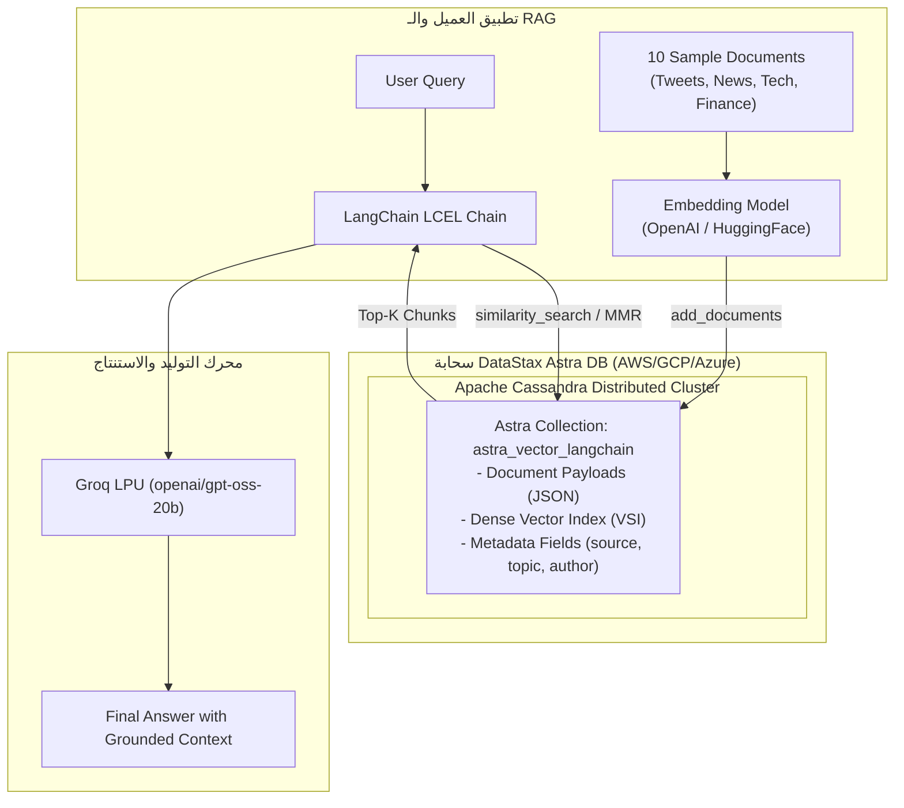

# الدرس 09: قاعدة بيانات المتجهات السحابية DataStax Astra DB
### Enterprise Serverless Vector Database on Apache Cassandra (Lecture 35)

مرحبًا بك في الدرس التاسع من مرحلة **فهارس وقواعد بيانات المتجهات (Vector Stores & Databases)**، والذي يغطي بالكامل **المحاضرة 35** من الكورس.

في هذا الدرس، ننتقل من فهارس المتجهات المحلية المضمنة إلى **قواعد بيانات المتجهات السحابية المتكاملة المدارة (Cloud-Native Enterprise Vector Databases)**، وتحديداً منصة **DataStax Astra DB** المبنية على محرك **Apache Cassandra** الموزع عالمياً.

---

## 📌 أهداف الدرس (Learning Objectives)

1. **فهم معمارية DataStax Astra DB**:
   - قاعدة بيانات متجهات سحابية بدون خوادم (Serverless Vector DB).
   - مبنية على محرك **Apache Cassandra** لتوفير توسع أفقي هائل (Linear Horizontal Scalability) وزمن وصول يقترب من الصفر (Near-Zero Latency).
2. **إعداد حساب السحابة وبيانات الاعتماد (Credentials)**:
   - إنشاء قاعدة بيانات سحابية باختيار مزود السحابة (AWS / GCP / Azure) والمنطقة الجغرافية (Region).
   - استخراج رابط البوابة السحابية **`ASTRA_DB_API_ENDPOINT`**.
   - توليد التوكن الأمني **`ASTRA_DB_APPLICATION_TOKEN`** من إعدادات الحساب مع صلاحيات `Database Administrator`.
3. **التكامل مع مكتبة LangChain (`langchain-astradb`)**:
   - استخدام كلاس `AstraDBVectorStore` للاتصال بالمجموعة (`astra_vector_langchain`).
   - استيعاب المستندات وتوليد المتجهات تلقائياً وتخزينها في جداول Cassandra السحابية.
4. **أنماط البحث المتقدم في Astra DB**:
   - البحث الدلالي بالتشابه (`similarity_search`).
   - **الفلترة الدقيقة بالـ Metadata** مباشرة على محرك السحابة (`filter={"source": "tweet"}`).
   - استخراج درجات الثقة ونسب التطابق الدلالي (`similarity_search_with_score`).
5. **المسترجعات المتقدمة (Advanced Retrievers)**:
   - مسترجع عتبة الثقة الدلالية (`search_type="similarity_score_threshold"`).
   - مسترجع تنوع النتائج ومنع التكرار (`search_type="mmr"` - Maximal Marginal Relevance).
6. **بناء خط أنابيب RAG متكامل**:
   - ربط المسترجع السحابي بنموذج اللغة فائق السرعة **Groq** وقالب الـ Prompt الصارم عبر لغة تعبير لانج تشين (**LCEL**).

---

## 🏛️ المعمارية العامة لـ DataStax Astra DB في مسار الـ RAG



---

## 🔑 خطوات الحصول على مفاتيح الاتصال من Astra DB (خطوة بخطوة):

1. **إنشاء الحساب (Sign Up):**
   - ادخل على الرابط: [astra.datastax.com](https://astra.datastax.com) وأنشئ حساباً مجانياً (لا يتطلب بطاقة ائتمان للبدء).
2. **إنشاء قاعدة البيانات (Create Database):**
   - اختر **Serverless Vector Database**.
   - اختر اسم القاعدة (مثلاً: `rag`).
   - اختر موفر السحابة (مثلاً: `Amazon Web Services`) والمنطقة الأقرب لك.
3. **نسخ رابط الـ API Endpoint:**
   - من صفحة نظرة عامة (Overview) أو تفاصيل الاتصال (Connection Details)، انسخ الرابط الذي ينتهي بـ `.apps.astra.datastax.com`:
     ```env
     ASTRA_DB_API_ENDPOINT="https://<YOUR_DATABASE_ID>-<REGION>.apps.astra.datastax.com"
     ```
4. **توليد التوكن السري (Generate Application Token):**
   - ادخل على **Account Settings** ثم **Tokens**.
   - اختر الدور: `Database Administrator` واضغط **Generate Token**.
   - انسخ التوكن السري (يبدأ بـ `AstraCS:...`):
     ```env
     ASTRA_DB_APPLICATION_TOKEN="AstraCS:your-secret-token-here"
     ```

---

## ⚖️ المقارنة: المخازن الموضعية مقابل قواعد البيانات السحابية

| المعيار | مخازن محلية (Chroma / FAISS) | DataStax Astra DB |
| :--- | :--- | :--- |
| **طبيعة المعمارية** | تعمل محلياً داخل جهاز المطور (Local Disk / RAM) | قاعدة بيانات موزعة مدارة بالكامل على السحابة (Distributed Cloud) |
| **التوافر العالي (HA)** | مرتبط بوجود وتشغيل جهاز المطور | 99.95%+ SLA مدعومة بنسخ احتياطي وتكرار عالمي |
| **حجم البيانات** | ممتاز حتى مئات الآلاف من المتجهات | بلا حدود (تتوسع لملايين ومليارات المتجهات بفضل Cassandra) |
| **صلاحية النشر (Deployment)** | صعبة في مشاريع الويب الحية (تُمسح عند Restart السيرفر) | **مثالية لمشاريع الـ CV والويب** (بياناتك محفوظة 24/7) |
| **التصفية (Filtering)** | تصفية محلية بالبايثون | تصفية سحابية فائقة السرعة على مستوى محرك قاعدة البيانات |

---

## 💻 شفرة الاتصال السريعة (Quick Start Code)

```python
import os
from dotenv import load_dotenv
from langchain_astradb import AstraDBVectorStore
from langchain_huggingface import HuggingFaceEmbeddings

load_dotenv()

# 1. تهيئة التضمين والمخزن السحابي
embeddings = HuggingFaceEmbeddings(model_name="sentence-transformers/all-MiniLM-L6-v2")

vector_store = AstraDBVectorStore(
    collection_name="astra_vector_langchain",
    embedding=embeddings,
    api_endpoint=os.getenv("ASTRA_DB_API_ENDPOINT"),
    token=os.getenv("ASTRA_DB_APPLICATION_TOKEN"),
    namespace="default_keyspace"
)

# 2. البحث مع الفلترة بالـ Metadata
results = vector_store.similarity_search(
    "What is happening in tech?",
    k=2,
    filter={"source": "tweet"}
)
```

---

> [!TIP]
> تجد في هذا المجلد الدفتر النموذجي المرجعي الشامل [09-astradb-vector-database.ipynb](./09-astradb-vector-database.ipynb)، كما يتوفر معمل التجارب المبسط مع مساحات التطبيق العملي التفاعلية في [`playground/03-vector-stores-and-databases/09-astradb-vector-database.ipynb`](../../../../playground/03-vector-stores-and-databases/09-astradb-vector-database.ipynb).
