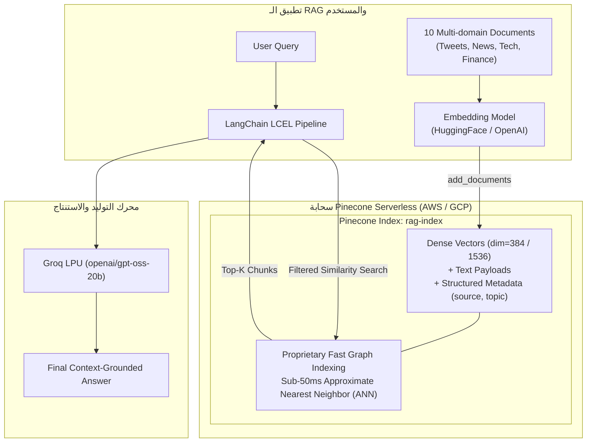

# الدرس 10: تخزين واسترجاع المتجهات على النطاق المؤسسي باستخدام Pinecone
### Enterprise Serverless Vector Database for Production AI (Lecture 36)

مرحبًا بك في الدرس العاشر والأخير من مرحلة **فهارس وقواعد بيانات المتجهات (Vector Stores & Databases)**، والذي يغطي بالكامل **المحاضرة 36** من الكورس.

في هذا الدرس، نتعرف على قاعدة البيانات الأكثر شهرة وانتشاراً في سوق العمل للذكاء الاصطناعي: **Pinecone Vector Database**.

---

## 📌 أهداف الدرس (Learning Objectives)

1. **فهم معمارية Pinecone السحابية (Vector-Native Architecture)**:
   - قاعدة بيانات صُممت خصيصاً من اليوم الأول لمعالجة وتخزين المتجهات الكثيفة (Dense Embeddings) بكفاءة فائقة.
   - معمارية بدون خوادم (**Serverless Architecture**) تفصل طبقة التخزين عن الحوسبة وتوفر توسعاً تلقائياً مع تسعير حسب الاستهلاك الفعلي (**Scale to Zero**).
2. **المفاهيم الهندسية الأساسية في Pinecone**:
   - **الفهرس (`Index`)**: الحاوية الأساسية لتخزين المتجهات والمستندات (يعادل الجدول في قواعد البيانات العلائقية).
   - **بُعد الفهرس (`Dimension`)**: عدد أرقام متجه التضمين؛ ويشترط تطابقه تماماً مع نموذج التضمين (مثل: `384` لـ HuggingFace أو `1536` لـ OpenAI).
   - **مقياس المسافة (`Metric`)**: دالة حساب التشابه (`cosine`, `dotproduct`, `euclidean`).
   - **مواصفات السحابة (`ServerlessSpec`)**: تحديد مزود السحابة والمنطقة الجغرافية (مثل `cloud="aws"`, `region="us-east-1"`).
3. **التكامل مع LangChain عبر `langchain-pinecone`**:
   - استخدام حزمة `pinecone` الرسمية وحزمة `langchain-pinecone`.
   - فحص وإنشاء الفهرس برمجياً عبر `pc.list_indexes()` و `pc.create_index()`.
   - تغليف الفهرس في كائن `PineconeVectorStore` لإدارته عبر واجهات لانج تشين الموحدة.
4. **أنماط البحث والفلترة السحابية**:
   - البحث بالتشابه الدلالي `similarity_search`.
   - **الفلترة بالبيانات الوصفية (Metadata Filtering)**: تصفية النتائج بسرعة فائقة على خوادم Pinecone مباشرة (`filter={"source": "tweet"}`).
   - استخراج درجات التشابه الدلالي `similarity_search_with_score`.
5. **بناء خط أنابيب RAG متكامل**:
   - تحويل الفهرس إلى مسترجع `Retriever` عبر `.as_retriever()`.
   - الربط بنموذج اللغة فائق السرعة **Groq** وقالب الـ Prompt عبر لغة تعبير لانج تشين (**LCEL**).

---

## 🏛️ المعمارية العامة لـ Pinecone في أنظمة الـ RAG



---

## 🔑 خطوات الحصول على مفتاح Pinecone (خطوة بخطوة):

1. **إنشاء حساب مجاني:**
   - ادخل على الرابط: [app.pinecone.io](https://app.pinecone.io) وسجل الدخول بحساب Google أو البريد الإلكتروني.
   - الباقة المجانية (**Starter Plan**) تتيح لك إنشاء فهارس Serverless وتخزين آلاف المتجهات مجاناً 100%.
2. **استخراج المفتاح السري (API Key):**
   - من القائمة الجانبية اليسرى، اضغط على **API Keys**.
   - انسخ المفتاح الافتراضي أو اضغط **Create API Key**.
3. **إضافته لملف `.env` في مشروعك:**
   ```env
   PINECONE_API_KEY="pcsk_your_secret_pinecone_key_here"
   ```

---

## ⚖️ المقارنة الكبرى: خريطة قواعد ومخازن المتجهات في الـ RAG

بانتهاء هذا الدرس، نكون قد غطينا كافة خيارات التخزين في **القسم السابع (Section 7: Vector Stores & Vector Databases)**:

| المعيار الهندسي | `InMemoryVectorStore` (L34) | `Meta FAISS` (L32-33) | `ChromaDB` (L25-27) | `DataStax Astra DB` (L35) | `Pinecone` (L36) |
| :--- | :--- | :--- | :--- | :--- | :--- |
| **وسيط التخزين** | رامات بايثون (`dict` + NumPy) | رامات الـ C++ (`IndexFlatL2`) | القرص المحلي (SQLite + Parquet) | سحابة مدارة (Cassandra) | سحابة مدارة بدون خوادم |
| **طبيعة المعمارية** | مضمنة في الذاكرة (Embedded) | مضمنة في الذاكرة (Embedded) | مضمنة على القرص (Embedded) | قاعدة بيانات سحابية موزعة | قاعدة بيانات متجهات سحابية متخصصة |
| **الحفظ الدائم** | ❌ يمسح فور إغلاق البرنامج | ⚠️ يدوي (`save_local` / `load_local`) | ✅ تلقائي وفوري على القرص | ✅ سحابي دائم ومحمي | ✅ سحابي دائم ومحمي |
| **السرعة وزمن الاستجابة** | < 1 ميلي ثانية (RAM) | < 5 ميلي ثانية (C++ RAM) | 10–50 ميلي ثانية (Local Disk) | 20–60 ميلي ثانية (Cloud API) | < 50 ميلي ثانية (Cloud Serverless) |
| **التصفية (Filtering)** | دوال بايثون (`lambda`) | تصفية بايثون محلية | شروط SQLite | استعلامات Cassandra سحابية | محرك فلترة سحابي فائق السرعة |
| **حجم البيانات المستهدف** | تجارب صغيرة (< 10,000) | حتى 1 مليون متجه محلياً | حتى 500,000 متجه محلياً | مليارات المتجهات | مليارات المتجهات |
| **الاستخدام المثالي** | اختبارات سريعة وشات مؤقت | بحث محلي فائق السرعة وأوفلاين | تطبيقات سطح المكتب والأجهزة المتوسطة | أنظمة المؤسسات الضخمة | **مشاريع الـ CV والمنتجات السحابية الحية** |

---

## 💻 طريقة الاستخدام السريعة في LangChain

```python
import os
from dotenv import load_dotenv
from pinecone import Pinecone, ServerlessSpec
from langchain_pinecone import PineconeVectorStore
from langchain_huggingface import HuggingFaceEmbeddings

load_dotenv()

# 1. تهيئة التضمين ومعرفة الأبعاد
embeddings = HuggingFaceEmbeddings(model_name="sentence-transformers/all-MiniLM-L6-v2")
dim = len(embeddings.embed_query("test"))

# 2. إنشاء والاتصال بفهرس Pinecone
pc = Pinecone(api_key=os.getenv("PINECONE_API_KEY"))
index_name = "rag-index"

if index_name not in [idx.name for idx in pc.list_indexes()]:
    pc.create_index(
        name=index_name,
        dimension=dim,
        metric="cosine",
        spec=ServerlessSpec(cloud="aws", region="us-east-1")
    )

vector_store = PineconeVectorStore(index=pc.Index(index_name), embedding=embeddings)

# 3. البحث مع الفلترة بالـ Metadata
results = vector_store.similarity_search(
    "What generative AI frameworks exist?",
    k=2,
    filter={"source": "tweet"}
)
```

---

> [!TIP]
> تجد في هذا المجلد الدفتر النموذجي المرجعي الشامل [10-pinecone-vector-database.ipynb](./10-pinecone-vector-database.ipynb)، كما يتوفر معمل التجارب المبسط مع مساحات التطبيق العملي التفاعلية في [`playground/03-vector-stores-and-databases/10-pinecone-vector-database.ipynb`](../../../../playground/03-vector-stores-and-databases/10-pinecone-vector-database.ipynb).
