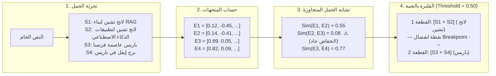

# الدرس 01: أساسيات وخوارزمية التقطيع الدلالي المتقدم
### Semantic Chunking Fundamentals & Breakpoint Architecture (Lecture 37)

مرحبًا بك في الدرس الأول من مرحلة **تقنيات التقطيع الدلالي المتقدم (Advanced Semantic Chunking)**، والذي يغطي بالكامل **المحاضرة 37** من الكورس.

---

## 📌 أهداف الدرس (Learning Objectives)

1. **إدراك عيوب التقطيع العادي بالأحرف (`Fixed-Size Splitting`)**:
   - كيف يتسبب عد الأحرف والرموز في **تمزيق الأفكار والجمل** في منتصفها.
   - ظاهرة **تلوث المتجهات (`Vector Smearing`)**: خلط مواضيع غير مترابطة في نفس القطعة مما يشوه فضاء المتجهات ويقلل دقة الاسترجاع.
2. **فهم فلسفة التقطيع الدلالي (`Semantic Chunking Philosophy`)**:
   - التقطيع بالمعنى بدلاً من مسطرة الحروف.
   - ضمان الخصائص الثلاث للقطع: **مستقلة بذاتها (`Self-Contained`)**، **غنية بالسياق (`Contextually Rich`)**، و**مفصولة منطقياً (`Logically Separated`)**.
3. **الخطوات الأربع لخوارزمية التقطيع الدلالي**:
   - **المرحلة 1: تجزئة المستند (`Document Segmentation`)**: تقسيم النص الخام إلى جمل مفردة.
   - **المرحلة 2: تضمين الجمل (`Sentence Embeddings`)**: حساب متجهات التضمين الكثيفة لكل جملة.
   - **المرحلة 3: قياس تشابه الجمل المتجاورة (`Pairwise Cosine Similarity`)**: حساب زاوية التشابه بين كل جملتين متتاليتين ($S_i$ و $S_{i+1}$).
   - **المرحلة 4: كشف نقاط الانفصال والدمج (`Threshold Boundary Detection`)**: دمج الجمل المتشابهة وقطع النص عند حدوث هبوط دلالي مفاجئ (`Semantic Drop / Breakpoint`).
4. **التمثيل البياني للمنحنى الدلالي**:
   - رصد وادي التشابه الدلالي بالعين المجردة لتحديد عتبة الفصل المثلى (`Threshold`).

---

## 🔬 الخوارزمية الرياضية خطوة بخطوة



---

## 💻 الكود البرمجي الأساسي (Quick Reference)

```python
import re
import numpy as np
from langchain_huggingface import HuggingFaceEmbeddings

# 1. تجزئة النص إلى جمل
text = "LangChain is a framework for RAG. LangChain builds AI apps. Paris is the capital of France. The Eiffel Tower is in Paris."
sentences = [s.strip() for s in re.split(r"(?<=[.!?])\s+", text) if s.strip()]

# 2. حساب المتجهات
embeddings = HuggingFaceEmbeddings(model_name="sentence-transformers/all-MiniLM-L6-v2")
vectors = [np.array(embeddings.embed_query(s)) for s in sentences]

# 3. حساب تشابه جيب التمام بين الجمل المتجاورة
def cos_sim(u, v):
    return float(np.dot(u, v) / (np.linalg.norm(u) * np.linalg.norm(v)))

similarities = [cos_sim(vectors[i], vectors[i+1]) for i in range(len(vectors)-1)]

# 4. دمج وفصل الجمل حسب العتبة
threshold = 0.50
chunks = []
current = [sentences[0]]

for i, sim in enumerate(similarities):
    if sim >= threshold:
        current.append(sentences[i+1])
    else:
        chunks.append(" ".join(current))
        current = [sentences[i+1]]
if current:
    chunks.append(" ".join(current))
```

---

> [!TIP]
> تجد في هذا المجلد الدفتر النموذجي المرجعي الشامل [01-semantic-chunking-fundamentals.ipynb](./01-semantic-chunking-fundamentals.ipynb)، كما يتوفر معمل التجارب المبسط مع مساحات التطبيق العملي التفاعلية في [`playground/04-advanced-chunking/01-semantic-chunking-fundamentals.ipynb`](../../../../playground/04-advanced-chunking/01-semantic-chunking-fundamentals.ipynb).
