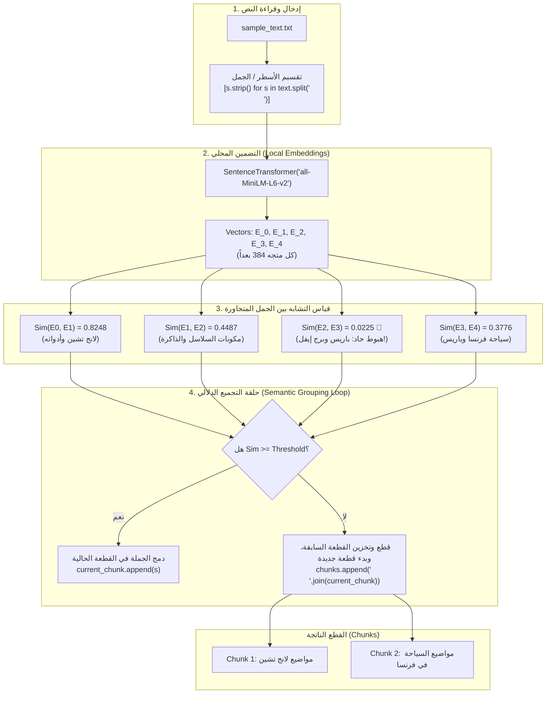

# الدرس 02: بناء محرك التقطيع الدلالي المتقدم بلغة بايثون
### Practical Semantic Chunking Engine in Pure Python (Lecture 38)

مرحبًا بك في الدرس الثاني من مرحلة **تقنيات التقطيع الدلالي المتقدم (Advanced Semantic Chunking)**، والذي يغطي بالكامل التطبيق العملي للـ **المحاضرة 38** من الكورس.

في هذا الدرس، ننتقل من الفهم النظري والمفاهيمي إلى **بناء خوارزمية التقطيع الدلالي بالكامل برمجياً باستخدام بايثون** خطوة بخطوة، مع استخدام مكتبات مفتوحة المصدر (`sentence-transformers` وموديل `all-MiniLM-L6-v2` و `scikit-learn`).

---

## 📌 أهداف الدرس (Learning Objectives)

1. **إعداد بيئة العمل المحلية**:
   - استدعاء مكتبة `sentence-transformers` وموديل التضمين المحلي الخفيف `all-MiniLM-L6-v2`.
   - استخدام دالة `cosine_similarity` من مكتبة `scikit-learn` لحساب تشابه الجمل.
2. **المراحل الأربع لبناء محرك الـ Semantic Chunking**:
   - **المرحلة 1: تجزئة المستند (`Segmentation`)**: قراءة النصوص وتقسيمها لجمل فردية نقية (`Stripped Sentences`).
   - **المرحلة 2: تضمين الجمل (`Sentence Embeddings`)**: توليد متجهات كثيفة (`Dense Vectors`) لكل جملة.
   - **المرحلة 3: قياس التشابه المتجاور (`Pairwise Cosine Similarity`)**: حساب زاوية التشابه الدلالي $\text{Sim}(S_i, S_{i+1})$.
   - **المرحلة 4: التجميع والقطع بالعتبة (`Threshold-based Semantic Grouping`)**: تجميع الجمل المتشابهة وقطع النص عند نقاط الانفصال (`Breakpoints`).
3. **تحليل أثر العتبة (`Threshold Tuning`)**:
   - كيف تؤثر العتبة العالية (مثلاً `0.70` كما بالفيديو) على إحكام القطع (`Tight Chunks`).
   - كيف تؤثر العتبة المتوازنة (مثلاً `0.35`) على دمج الموضوعات المترابطة تلقائياً.

---

## 🔬 المعمارية ومخطط التدفق (Workflow Diagram)



---

## 📊 البيانات التجريبية ونتائج القياس الفعلية

عند تطبيق الخوارزمية على النص التالي:
1. `LangChain is a framework for building applications with LLMs.`
2. `LangChain provides modular abstraction to combine LLMs with tools like OpenAI and Pinecone.`
3. `You can create chains, agents, memory, and retrievers.`
4. `The Eiffel Tower is located in Paris.`
5. `France is a popular tourist destination.`

### نتائج التشابه الزوجي (`Cosine Similarity`):
- **بين الجملة 1 و 2:** `0.8248` ⬅️ ترابط دلالي عالي جداً (كلاهما يذكر لانج تشين والموديلات).
- **بين الجملة 2 و 3:** `0.4487` ⬅️ ترابط متوسط (الجملة 3 تذكر مكونات المعمارية بدون ذكر كلمة لانج تشين صراحة).
- **بين الجملة 3 و 4:** `0.0225` ⬅️ **انقطاع دلالي شبه كامل (Cliff Drop)** (الانتقال من الذكاء الاصطناعي لبرج إيفل).
- **بين الجملة 4 و 5:** `0.3776` ⬅️ ترابط متوسط (برج إيفل وسياحة فرنسا).

---

## ⚙️ أثر ضبط العتبة (`Threshold Tuning`)

| قيمة العتبة (`Threshold`) | عدد القطع (`Chunks`) | سلوك التقطيع | التقييم الهندسي |
| :---: | :---: | :--- | :--- |
| **`0.70` (مُحكم - كما بالفيديو)** | 4 قطع | `Chunk 1`: الجملتان 1 و2.<br>`Chunk 2`: الجملة 3 منفردة.<br>`Chunk 3`: الجملة 4 منفردة.<br>`Chunk 4`: الجملة 5 منفردة. | ممتاز للبحث فائق الدقة عن جمل محددة، لكنه يفتت السياق قليلاً. |
| **`0.35` (متوازن موضوعياً)** | قطعتان فقط | `Chunk 1`: الجمل 1 و2 و3 (سياق الذكاء الاصطناعي ولانج تشين كاملاً).<br>`Chunk 2`: الجملتان 4 و5 (سياق فرنسا وباريس كاملاً). | مثالي لأنظمة الـ RAG في الإنتاج لتقديم سياق كامل ومترابط للـ LLM. |

---

## 💡 كود المرجع السريع (Core Python Implementation)

```python
from sentence_transformers import SentenceTransformer
from sklearn.metrics.pairwise import cosine_similarity

# 1. تحميل الموديل وتجهيز النص
model = SentenceTransformer("all-MiniLM-L6-v2")
sentences = [
    "LangChain is a framework for building applications with LLMs.",
    "LangChain provides modular abstraction to combine LLMs with tools like OpenAI and Pinecone.",
    "You can create chains, agents, memory, and retrievers.",
    "The Eiffel Tower is located in Paris.",
    "France is a popular tourist destination.",
]

# 2. حساب التضمينات
embeddings = model.encode(sentences)

# 3. إعداد بارامترات التقطيع
threshold = 0.7  # أو 0.35 حسب الرغبة
chunks = []
current_chunk = [sentences[0]]

# 4. حلقة التجميع والمقارنة الدلالية
for i in range(1, len(sentences)):
    sim = cosine_similarity([embeddings[i - 1]], [embeddings[i]])[0][0]
    if sim >= threshold:
        current_chunk.append(sentences[i])
    else:
        chunks.append(" ".join(current_chunk))
        current_chunk = [sentences[i]]

# إضافة القطعة الأخيرة
if current_chunk:
    chunks.append(" ".join(current_chunk))

# عرض النتائج
for idx, chunk in enumerate(chunks, 1):
    print(f"[Chunk {idx}]: {chunk}\n")
```

---

## 🧭 الملفات المرفقة بالدرس
- **الملف النصي الخام**: [`sample_text.txt`](./sample_text.txt)
- **دفتر التنفيذ الكامل مع المخرجات**: [`02-semantic-chunking-python.ipynb`](./02-semantic-chunking-python.ipynb)
- **دفتر التدريب التفاعلي المقابل**: [`playground/04-advanced-chunking/02-semantic-chunking-python.ipynb`](../../../playground/04-advanced-chunking/02-semantic-chunking-python.ipynb)
