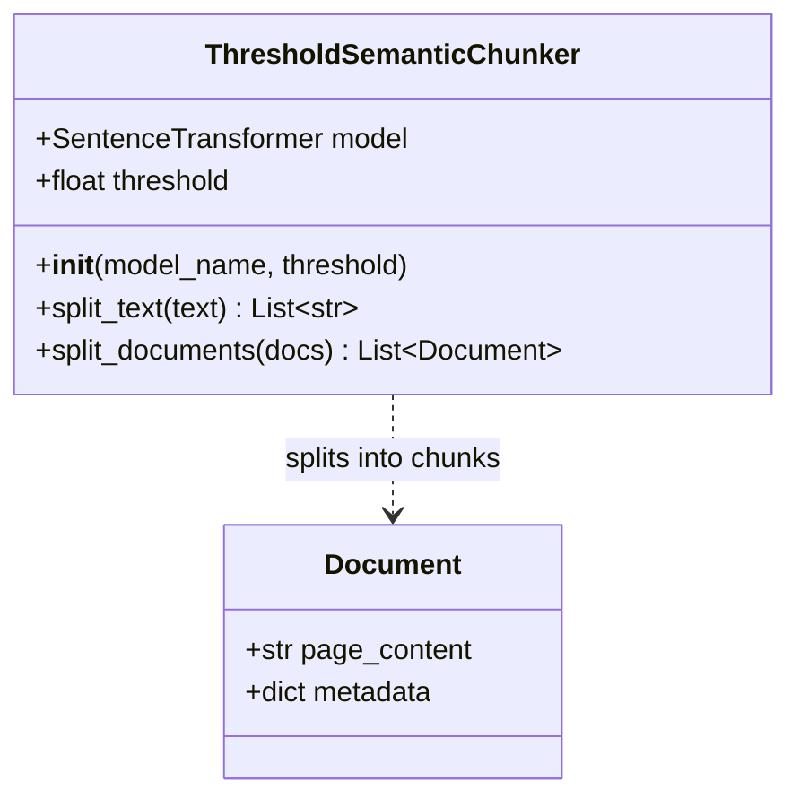
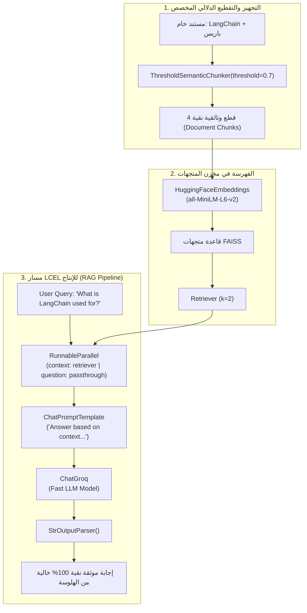

# الدرس 03: بناء مسار RAG كامل مدمج به التقطيع الدلالي البرمجي المخصص
### Building an End-to-End RAG Pipeline with Custom Modular Semantic Chunker (Lecture 39)

مرحبًا بك في الدرس الثالث من مرحلة **تقنيات التقطيع الدلالي المتقدم (Advanced Semantic Chunking)**، والذي يغطي بالكامل **المحاضرة 39** من الكورس.

في هذا الدرس، ننتقل من مجرد كتابة دوال منفصلة (`Procedural Functions`) إلى **البرمجة المعيارية كائنية التوجه (`Modular Object-Oriented Programming`)** عبر بناء كلاس مخصص متوافق تماماً مع بنية وثائق لانج تشين (`LangChain Documents`)، ثم دمجه داخل **مسار RAG كامل للإنتاج** مبني بتعبيرات `LCEL` مع قاعدة متجهات `FAISS` وموديل لغوي سريع عبر `Groq`.

---

## 📌 أهداف الدرس (Learning Objectives)

1. **البرمجة المعيارية (`Modular Coding`)**:
   - بناء كلاس بايثون احترافي قابل لإعادة الاستخدام: `ThresholdSemanticChunker`.
   - تغليف بارامترات التضمين والعتبة داخل دالة البناء (`__init__`).
   - دعم التقطيع النصي المباشر عبر دالة `split_text(text: str) -> List[str]`.
   - دعم التقطيع الوثائقي عبر دالة `split_documents(docs: List[Document]) -> List[Document]` مع الحفاظ على الـ `Metadata`.
2. **فهرسة وتخزين القطع في قاعدة متجهات (`Vector Store Ingestion`)**:
   - تحويل القطع الدلالية الناتجة إلى متجهات وحفظها داخل فهرس `FAISS`.
   - تحويل مخزن المتجهات إلى مسترجع ذكي: `retriever = vector_store.as_retriever(search_kwargs={"k": 2})`.
3. **بناء مسار الاسترجاع والتوليد بتعبيرات `LCEL`**:
   - ربط المسترجع بالـ `Prompt Template` عبر `RunnableParallel` أو `RunnableMap`.
   - تمرير السياق المسترجع إلى الموديل اللغوي `ChatGroq`.
   - تحويل المخرجات إلى نصوص نقية باستخدام `StrOutputParser`.
4. **التحقق العملي من دقة الإجابة وانعدام التشتت**:
   - إثبات أن الإجابة عن `LangChain` تستند فقط إلى القطع الدلالية المعنية وتتجاهل تماماً أي معلومات غير متعلقة (مثل برج إيفل وفرنسا).

---

## 🏛️ المعمارية العامة ومخطط التدفق (Architecture Diagrams)

### 1. معمارية الكلاس المخصص (`ThresholdSemanticChunker Class`)



### 2. مسار الـ RAG الكامل (`End-to-End LCEL Flow`)



---

## 💻 الكود البرمجي الأساسي (Quick Reference)

### كلاس الـ Chunker المخصص:

```python
from typing import List
from sentence_transformers import SentenceTransformer
from sklearn.metrics.pairwise import cosine_similarity
from langchain_core.documents import Document

class ThresholdSemanticChunker:
    """محرك تقطيع دلالي مخصص متوافق مع بنية وثائق LangChain."""
    
    def __init__(self, model_name: str = "all-MiniLM-L6-v2", threshold: float = 0.7):
        self.model = SentenceTransformer(model_name)
        self.threshold = threshold

    def split_text(self, text: str) -> List[str]:
        sentences = [s.strip() for s in text.split("\n") if s.strip()]
        if not sentences:
            return []
        
        embeddings = self.model.encode(sentences)
        chunks = []
        current_chunk = [sentences[0]]

        for i in range(1, len(sentences)):
            sim = cosine_similarity([embeddings[i - 1]], [embeddings[i]])[0][0]
            if sim >= self.threshold:
                current_chunk.append(sentences[i])
            else:
                chunks.append(" ".join(current_chunk))
                current_chunk = [sentences[i]]

        if current_chunk:
            chunks.append(" ".join(current_chunk))
        return chunks

    def split_documents(self, docs: List[Document]) -> List[Document]:
        result = []
        for doc in docs:
            chunks = self.split_text(doc.page_content)
            for chunk in chunks:
                result.append(Document(page_content=chunk, metadata=doc.metadata.copy()))
        return result
```

### مسار الـ RAG عبر LCEL:

```python
from langchain_community.vectorstores import FAISS
from langchain_huggingface import HuggingFaceEmbeddings
from langchain_groq import ChatGroq
from langchain_core.prompts import ChatPromptTemplate
from langchain_core.output_parsers import StrOutputParser
from langchain_core.runnables import RunnableParallel

# 1. التخزين في FAISS
embeddings = HuggingFaceEmbeddings(model_name="sentence-transformers/all-MiniLM-L6-v2")
vector_store = FAISS.from_documents(chunks, embeddings)
retriever = vector_store.as_retriever(search_kwargs={"k": 2})

# 2. بناء الـ Prompt والـ LLM
prompt = ChatPromptTemplate.from_template("""Answer the question based on the following context:
Context: {context}
Question: {question}""")

llm = ChatGroq(model="openai/gpt-oss-20b", temperature=0.4)

# 3. بناء سلسلة LCEL
rag_chain = (
    RunnableParallel(
        context=(lambda x: x["question"]) | retriever,
        question=lambda x: x["question"]
    )
    | prompt
    | llm
    | StrOutputParser()
)

# 4. الاستعلام
response = rag_chain.invoke({"question": "What is LangChain used for?"})
print(response)
```

---

## 🧭 الملفات المرفقة بالدرس
- **الملف النصي التجريبي**: [`sample_text.txt`](./sample_text.txt)
- **دفتر التنفيذ الكامل مع المخرجات**: [`03-building-rag-semantic-chunker.ipynb`](./03-building-rag-semantic-chunker.ipynb)
- **دفتر التدريب التفاعلي المقابل**: [`playground/04-advanced-chunking/03-building-rag-semantic-chunker.ipynb`](../../../playground/04-advanced-chunking/03-building-rag-semantic-chunker.ipynb)
