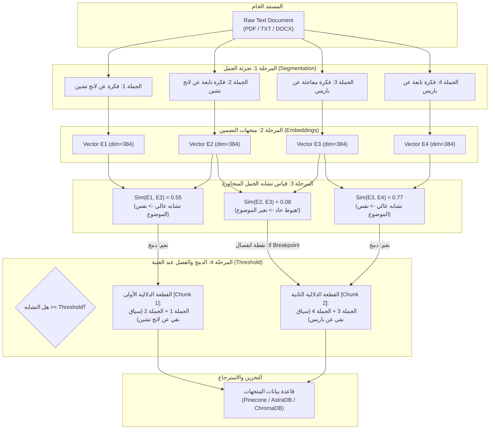

# 04 - تقنيات التقطيع الدلالي المتقدم (Advanced Semantic Chunking)

المرحلة الرابعة في مسار إتقان الـ RAG، وتغطي بالكامل **القسم الثامن من الكورس (Section 8: Advanced Chunking And Preprocessing Techniques - المحاضرات 37 إلى 40)**.

تتناول هذه المرحلة الانتقال من التقطيع البسيط القائم على حساب عدد الأحرف والرموز (`Fixed-Size Character Splitting`) إلى **التقطيع الدلالي الذكي (`Semantic Chunking`)** القائم على قياس المعنى والترابط الموضوعي بين الجمل.

---

## 🧭 خارطة موضوعات المرحلة (Curriculum)

| الرقم | المجلد الفرعي | عنوان الدرس (Topic) | المحاضرة المقابلة | الشرح (.md) | الدفتر المرجعي (.ipynb) | الحالة |
| :---: | :--- | :--- | :---: | :---: | :---: | :---: |
| 01 | **[01-semantic-chunking-fundamentals](./01-semantic-chunking-fundamentals/)** | أساسيات وخوارزمية التقطيع الدلالي ونقاط الانفصال | Lecture 37 | [README](./01-semantic-chunking-fundamentals/README.md) | [Notebook](./01-semantic-chunking-fundamentals/01-semantic-chunking-fundamentals.ipynb) | [x] مكتمل |
| 02 | **[02-semantic-chunking-python](./02-semantic-chunking-python/)** | بناء محرك التقطيع الدلالي بلغة بايثون من الصفر | Lecture 38 | [README](./02-semantic-chunking-python/README.md) | [Notebook](./02-semantic-chunking-python/02-semantic-chunking-python.ipynb) | [x] مكتمل |
| 03 | **[03-building-rag-semantic-chunker](./03-building-rag-semantic-chunker/)** | بناء مسار RAG كامل مدمج به الـ Semantic Chunker | Lecture 39 | [README](./03-building-rag-semantic-chunker/README.md) | [Notebook](./03-building-rag-semantic-chunker/03-building-rag-semantic-chunker.ipynb) | [x] مكتمل |
| 04 | **04-semantic-chunking-langchain** | التقطيع الدلالي الجاهز باستخدام مكتبة LangChain | Lecture 40 | قيد العمل | قيد العمل | [ ] قادم |

---

## 🏛️ المعمارية العامة للتقطيع الدلالي (Semantic Chunking Architecture)

---

## ⚖️ المقارنة: التقطيع العادي مقابل التقطيع الدلالي

| وجه المقارنة | التقطيع العادي (`RecursiveCharacterTextSplitter`) | التقطيع الدلالي (`Semantic Chunking`) |
| :--- | :--- | :--- |
| **معيار التقطيع** | عدد الحروف والرموز الثابتة (مثلاً 500 حرف) | التشابه الدلالي وتغير سياق الفكرة |
| **سلامة الجمل والأفكار** | منخفضة (قد يتم قطع الجملة في منتصفها) | ممتازة (كل قطعة تمثل فكرة كاملة ومستقلة) |
| **نقاء المتجهات (Vector Purity)** | مشوش؛ يخلط موضوعات مختلفة في نفس القطعة | نقي 100%؛ المتجه يمثل معنى واحداً واضحاً |
| **التكلفة والسرعة** | فائقة السرعة وفورية (مجرد تقطيع نصوص) | تتطلب حساب Embeddings لكل جملة أولاً |
| **التأثير على الـ RAG** | زيادة خطر الهلوسة وضعف دقة الاسترجاع | استرجاع دقيق وإجابات موثقة بالكامل من السياق |
