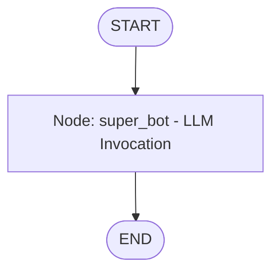

# Stage 10 / Module 06: LLM Chatbot with Reducers and Pregel Streaming

## Architectural Overview

This module transitions from deterministic graphs to conversational artificial intelligence agents powered by Large Language Models (LLMs). We implement **SuperBot**, a stateful conversational workflow executing on LangGraph's Pregel engine.

### Core Concepts

1. **State Reducers (`Annotated[list, add_messages]`)**:
   - Eliminates standard shallow state overwrite behavior.
   - Merges inbound message deltas into an immutable, append-only conversation log.
   - De-duplicates and updates messages matching identical unique message identifiers (`id`).

2. **Multi-Model Fallback Architecture**:
   - High-throughput, ultra-low latency Groq LPU engine (`openai/gpt-oss-20b` or `qwen/qwen3.8-27b`).
   - Commercial tier OpenAI inference (`ChatOpenAI` wrapper) with automatic dynamic credential resolution.

3. **Execution Modes**:
   - **Invocation (`.invoke()`)**: Blocks until graph reaches terminal `END` sentinel, returning consolidated final state.
   - **Streaming (`.stream()`)**: Yields a generator emitting step events in real time.
     - `stream_mode="updates"`: Returns isolated node deltas for bandwidth-efficient consumption.
     - `stream_mode="values"`: Emits full state snapshots after each Pregel superstep.

---

## Topology

---

## Technical Specifications

- **State Schema**: `TypedDict` with `messages: Annotated[Sequence[BaseMessage], add_messages]`.
- **Node Contract**: `super_bot(state: ChatState) -> Dict[str, List[BaseMessage]]`.
- **Defensive Engineering**: Automated token capping (`max_tokens`), graceful credential fallback, and type assertions.
